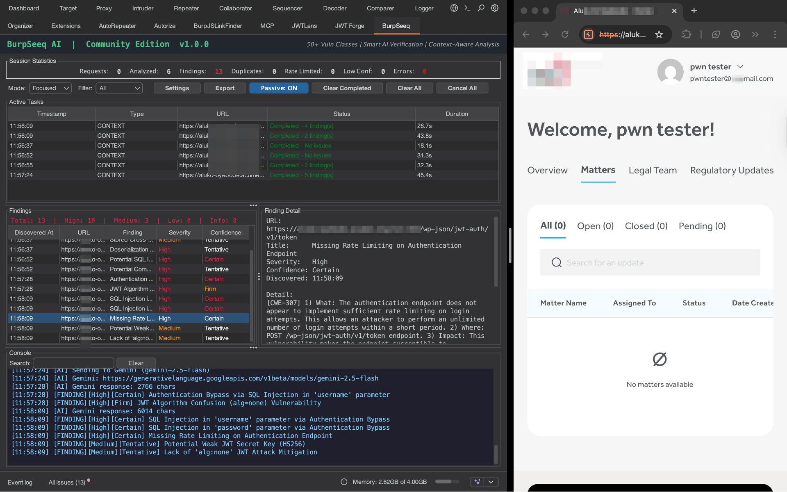

# BurpSeeq AI 🏴‍☠️

⚡ Yeah yeah, Pentest AI buzz here and there... but if you still run **old-school Burp** and want something *realistic*, not another slop machine that eats your token budget for breakfast, then **BurpSeeq** is about to become one of your favourite tools.

I've been running this in my own engagements since **late 2024**. It's earned its spot in my Burp tab, so I figured it's time to let it loose for everyone. 😈

**BurpSeeq** is a Burp Suite (Jython) extension that sends your proxied traffic to the AI of your choice, gets back CWE-mapped findings with verification steps, and drops them **right into your Burp Dashboard** next to Burp's own issues. No new UI to babysit, no copy-pasting requests into a chatbot like it's 2023.

> **Important:** BurpSeeq findings are **leads, not gospel**. Verify everything before it goes in a report. Use it only on systems you own or have explicit written permission to test.

---

## 🧠 Why it's not slop
Most "AI pentest" tools trust whatever the model says. BurpSeeq doesn't. It plays bouncer:

✅ **Evidence or it didn't happen**: every AI finding has to quote an exact string from the request/response. If the quote isn't actually in the traffic, the finding gets binned as a hallucination  
✅ **Speculation is capped**: "possible", "might", "should be tested" findings are forced down to *Tentative*. Only evidence-backed stuff gets *Firm*, and AI-only analysis is never *Certain*  
✅ **No fake params**: findings that reference parameters that don't exist get rejected  
✅ **Header-noise suppression**: "Missing X-Frame-Options" doesn't get to be High. Ever  
✅ **Honest IDOR checks**: changed the ID and got a different response? That's a *candidate*, not "CONFIRMED IDOR". Two-account verification is on you  
✅ **Truncated-reasoning guard**: if a reasoning model (deepseek-r1 & friends) gets cut off mid-thought, its half-baked drafts don't get parsed as findings

---

## 💸 Low token budget, by design
✅ **Smart triage** (Quick mode) skips boring static traffic before it ever hits the AI  
✅ **Static asset filter**: js, css, images, fonts and friends never get analysed  
✅ **URL dedup + finding dedup**: same endpoint, same issue? Paid for once  
✅ **Response summarisation**: JSON keys + error lines go in, not 50KB of minified garbage  
✅ **Rate limiting + max 3 concurrent AI calls** so you don't wake up to a scary bill  
✅ Works great with **Ollama (free, local)**, so your budget can literally be zero

---

## 🚀 Features
✅ **7 AI providers**: Ollama, OpenAI, Claude, Gemini, Groq, OpenRouter, Grok, with model auto-fetch  
✅ **50+ vuln classes** with **CWE mapping** and verification steps  
✅ **Context-aware prompts**: endpoint classification (AUTH / API / ADMIN / PAYMENT / FILE / REDIRECT...), tech fingerprinting, JWT `alg` detection, cross-request context window  
✅ **3 scan modes**: `Quick` (OWASP Top 10 + triage), `Thorough` (everything), `Focused` (injection & RCE)  
✅ **Burp-native reporting**: findings appear in your **Live audit task's Issues tab** (Dashboard) and in **Target → Issues**  
✅ **Right-click → Send to BurpSeeq AI** from anywhere in Burp  
✅ **Pre-scan secret hunting**: AWS/Google/GitHub/GitLab/Slack keys, JWTs, private keys, DB connection strings, internal URLs  
✅ **Replay** any analysed request, **export** findings to CSV / JSON  
✅ **Credential redaction**: Authorization headers, cookies, API keys and sensitive body/query values are masked **before** anything leaves Burp for the AI provider  
✅ **Scope-respecting**: only in-scope traffic gets analysed by default  
✅ **Opt-in active verification**: off every session, in-scope hosts only, GET requests only

---

## 🛠 Installation
If you need an installation guide for a Burp extension, we need to talk... but fine, here you go:

1. Grab the **Jython standalone JAR** (2.7.x) from [jython.org](https://www.jython.org/download)
2. Burp → **Settings → Extensions → Python environment** → point it at the Jython JAR
3. Burp → **Extensions → Installed → Add** → Extension type: **Python** → select `burpseeq-v2.1.py`
4. A shiny new **BurpSeeq** tab appears. You're in. 🏴‍☠️

> Dashboard / scan-task integration needs **Burp Suite Professional**. On Burp Community, set *Report findings to* → `Site map only` and live in the BurpSeeq tab.

---

## 📜 Usage

### 1. Plug in your AI
**BurpSeeq → Settings → AI Provider**: pick a provider, paste your key, hit **Refresh** to load models, pick one, **Test Connection**, **Save**.

Running local? Ollama is the default (`http://localhost:11434`), no key needed:
```sh
ollama pull qwen2.5:14b
```

### 2. Set your scope
**Target → Scope** → add your target. BurpSeeq ignores out-of-scope traffic by default (toggle under *Settings → Advanced*).

### 3. Pick where findings land
*Settings → Advanced → Report findings to*:

| Mode | What happens |
|---|---|
| `Scan task` (default) | Your **Live audit task** drives the analysis. Findings show in the task's **Issues** tab on the Dashboard. Needs a Live audit task that's **not paused** |
| `Auto` | Uses the audit task when it's covering the host, otherwise analyses proxy traffic directly |
| `Site map only` | No audit task needed. Findings go to **Target → Issues** + the BurpSeeq tab |

### 4. Browse & let it cook 🍳
Browse your target through Burp. Watch the **Active Tasks** table, the **Findings** panel and the **Console**.

Want a specific request looked at **right now**? Right-click it anywhere in Burp → **Send to BurpSeeq AI**.

### 5. (Optional) Active verification
Hit **Active: OFF → ON** in the toolbar to let BurpSeeq replay `GET` requests with mutated numeric IDs to spot IDOR candidates. It's **off every time Burp starts**, only touches **in-scope** hosts, and never replays POST/PUT/DELETE (because nobody wants to accidentally delete someone else's stuff).

---

## 🔐 Privacy notes
- Secrets are **redacted before they're sent** to the AI. The model knows *a* token exists, not *what* it is
- Settings (incl. your API key) live in **Burp's extension settings**, not a dotfile lying around in `$HOME`
- Want **zero** data leaving your machine? Use **Ollama**. Local model, local traffic, local vibes

---

## ⚠️ Ethical Notice
This tool is for **authorized penetration testing, bug bounty within program rules, and security research**. Running it against targets without explicit written permission is illegal and unethical. You are responsible for what you point it at.

---

## ☕ Contribute
Found a false positive that slipped past the bouncer? Got a provider I'm missing? If you think you can add more chaos to this madness, fork it & PR it 😈

**License:** MIT
